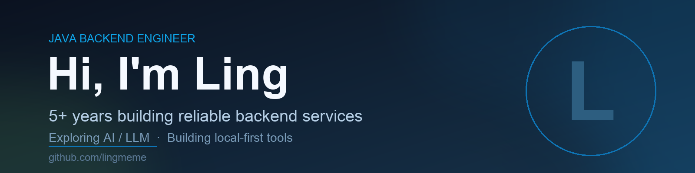

  

<h3 align="center">Java 后端工程师 · 5+ 年经验 · 正在研究 AI / LLM</h3>

  写后端服务，也折腾本地优先的小工具。

  <a href="https://lingmeme.github.io/document/"><b>Blog</b></a>
  &nbsp;·&nbsp;
  <a href="https://github.com/lingmeme?tab=repositories"><b>Repositories</b></a>
  &nbsp;·&nbsp;
  <a href="https://github.com/lingmeme"><b>GitHub</b></a>

---

### 🧰 Tech Stack

  
  
  
  
  
  
  
  
  
  

### 🚀 Featured Projects

- **[coding-base](https://github.com/lingmeme/coding-base)** — Java 基础、刷题、IO、JUC
- **[MyLearningAiProject](https://github.com/lingmeme/MyLearningAiProject)** — AI / LLM 学习与实践
- **[coding-rpc](https://github.com/lingmeme/coding-rpc)** — 手写 RPC，理解通信与代理
- **[somedemo](https://github.com/lingmeme/somedemo)** — Java 日常示例

### 🌱 Currently

- 🔭 在做：本地优先的 A 股复盘小工具（Python + 原生 Web）
- 🌱 在学：LLM 工程化、RAG、Agent
- 💬 可以聊：Java、Spring、消息队列、分布式系统

### 📫 Find me

- Blog: <https://lingmeme.github.io/document/>
- GitHub: <https://github.com/lingmeme>

---

  Thanks for stopping by · 保持好奇，持续学习。

